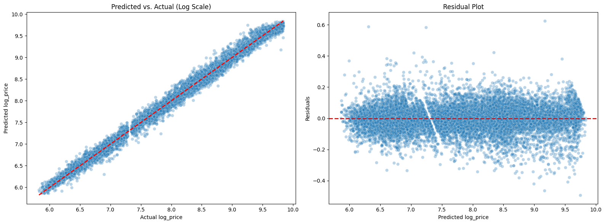
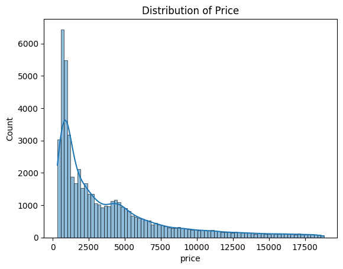
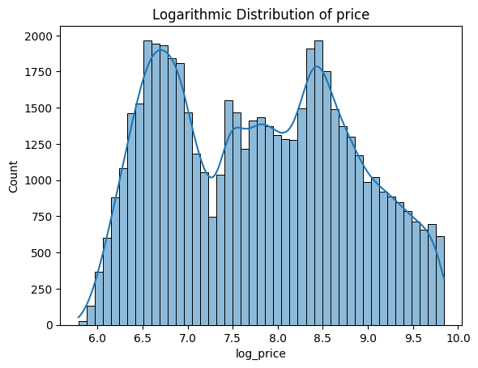

# Advanced Regression Modelling — Predicting Diamond Prices


An OLS regression study on 53,940 diamonds that treats **interpretability as a first-class constraint**. The goal isn't just a high R² — it's a specification whose coefficients can actually be read, which means fighting multicollinearity between physical dimensions that are, by construction, almost the same variable.

> Coursework for DAT-5329 Machine Learning, MSc Finance, Hult International Business School — written by Alexandre Ly.

---

## Results at a glance

| Specification | R² | Note |
|---|---|---|
| `log_price ~ carat` | 0.847 | Raw carat, untransformed |
| `log_price ~ log_carat` | 0.909 | Log–log improves fit |
| `log_price ~ log_length_mm` | 0.912 | Best single predictor |
| **Final: `log_length_mm + cut_code + color_code + clarity_code − 1`** | **0.997** | Intercept suppressed; **uncentered** R² (centered: 0.838) |
| Same predictors, with intercept | 0.950 | Centered R², comparable to the rows above |

> **Reading the 0.997.** With the intercept dropped, statsmodels reports an *uncentered* R², which is not comparable to the centered R² of the models above it. Measured on the same centered basis, the final specification scores 0.838, below `log_length_mm` alone (0.912), and the version with an intercept scores 0.950.

Residual diagnostics below are for the final specification, on the log scale.



---

## What's in this repo

| File | What it does |
|---|---|
| [`A2_Advanced_Regression_Diamond_Prices.ipynb`](A2_Advanced_Regression_Diamond_Prices.ipynb) | Full analysis: EDA → transformations → correlation study → OLS iterations → diagnostics |
| `*.png` | Exported charts used in this README |

**Open in Colab:** [Run the notebook](https://colab.research.google.com/github/alexly0329-cpu/diamond-price-regression/blob/main/A2_Advanced_Regression_Diamond_Prices.ipynb)
**Open View Rendered Notebook (if you do not want to create a google account):** [Run the notebook](https://nbviewer.org/github/alexly0329-cpu/AdvancedRegression-Modelling/blob/main/A2_Advanced_Regression_Diamond_Prices.ipynb)

The dataset is the classic `diamonds` set loaded directly from `seaborn`, with columns renamed for clarity (`x → length_mm`, `y → width_mm`, `z → depth_mm`, `depth → depth_pct`). No data file needed.

---

## Method

**1. Transformation.** Price is sharply right-skewed. A log transform turns it into a workable near-normal target, and the same treatment is applied to carat and the three physical dimensions — moving the whole model into log–log space, where coefficients read as elasticities.

<p align="center">
  
  
</p>

**2. Correlation study.** Pearson correlations are supplemented with **Phik (φk)**, which captures non-linear and mixed-type association and handles the ordinal grading variables (cut, colour, clarity) properly. Against `log_price`, `log_length_mm` is the strongest physical predictor at 0.92. Eleven features correlate more strongly with `log_price` than with raw `price`, confirming the transformed target.

**3. Specification.** Three deliberate design decisions:

- **One dimension, not three.** Length, width, and depth are near-collinear — a bigger diamond is bigger in every direction. Keeping all three inflates the condition number and destabilises coefficients without adding information. `log_length_mm` stands in for size.
- **Ordinal encoding for the 4Cs.** Cut, colour, and clarity are graded scales, not unordered categories, so they're encoded in their true quality order rather than one-hot expanded.
- **Intercept suppression (`− 1`).** With all predictors on similar log/ordinal scales, dropping the intercept sharply reduces the condition number. The trade-off: R² is reported uncentered and is not directly comparable to the intercept models above it. On a centered basis the no-intercept model fits worse (0.838 vs 0.950), and the cut and colour coefficients flip sign (negative without the intercept, positive with it), so the lower condition number (10.7 vs 97.7) buys numerical stability rather than a better-behaved model.

---

## A data quality finding worth flagging

The dataset ships a `depth_pct` column that should equal `2 × depth_mm / (length_mm + width_mm) × 100`. Recomputing it, **96.7% of rows reconcile** within 0.1 percentage points.

The other 3.3% (1,765 rows) do not. Most of those gaps are rounding-scale (median 0.15 pt), but 20 rows have a zero-valued dimension, which is physically impossible. Those are worth raising with whoever supplies the data. The notebook flags them rather than quietly dropping the column.

---

## Running it yourself

```bash
git clone https://github.com/alexly0329-cpu/diamond-price-regression.git
cd diamond-price-regression
pip install -r requirements.txt
jupyter notebook
```

> The first cell clones a course helper repository (`BASD`) and installs `baserush`, used for stepwise feature selection utilities. It runs cleanly in Google Colab; locally you can skip that cell — the core OLS analysis relies only on `statsmodels`.

---

## Tech stack

`pandas` · `numpy` · `statsmodels` · `scikit-learn` · `phik` · `seaborn` · `matplotlib`

---

## Author

**Alexandre Ly** — MSc Finance (STEM), Hult International Business School
[LinkedIn](https://linkedin.com/in/alexandre-t-ly)
